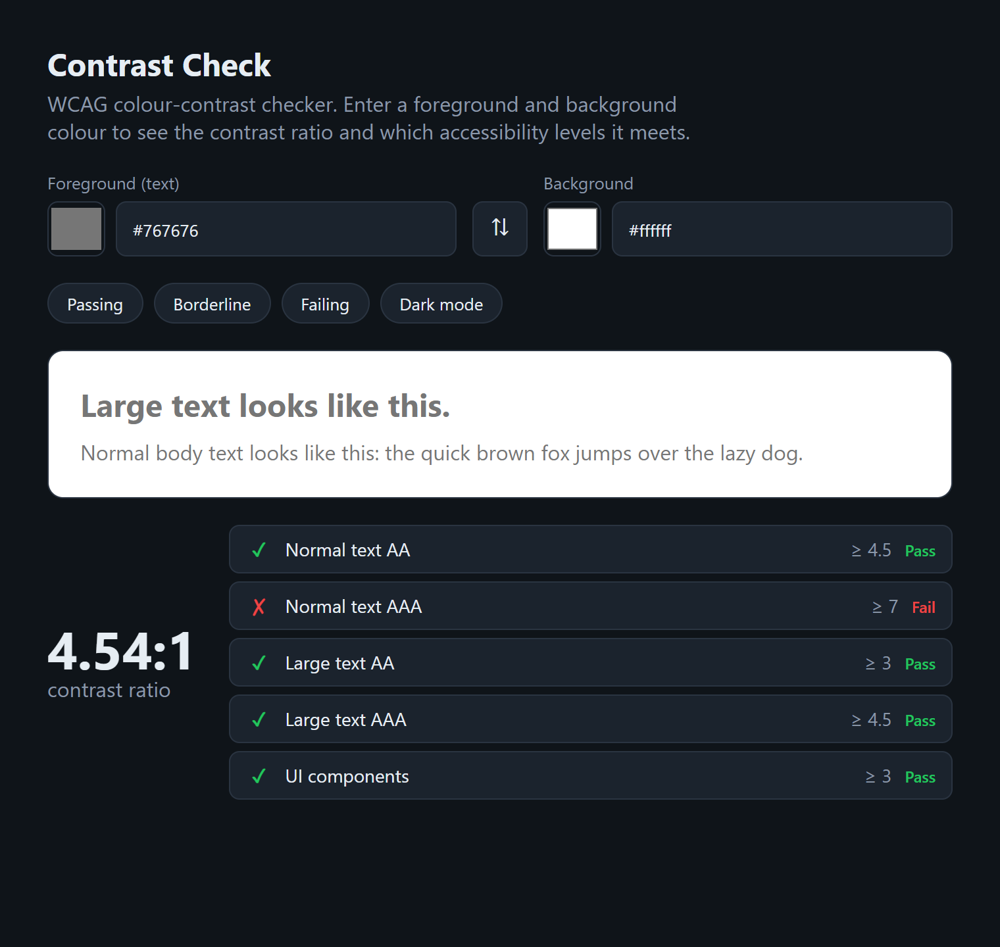

# Contrast Check

[](https://github.com/BoogeyCodes/contrastcheck/actions/workflows/ci.yml)


A WCAG colour-contrast checker, built with React and TypeScript. Pick a foreground and background
colour and see the contrast ratio, a live preview, and exactly which accessibility levels the pair
meets — and when it fails, the closest accessible colour that passes.



## Why

Readable colour is an accessibility requirement, not a nicety: WCAG sets minimum contrast ratios for
text and UI components, and failing them makes a product unusable for people with low vision. This
tool makes the check immediate — type two colours, see the ratio and the pass/fail for every
criterion — and the interesting part, the contrast maths, is a small, well-tested module rather than
a black box.

## What it does

- **Live ratio** between a foreground and background colour, from `1:1` to `21:1`.
- **Every WCAG criterion** at a glance: normal-text AA (≥ 4.5) and AAA (≥ 7), large-text AA (≥ 3) and
  AAA (≥ 4.5), and UI-component contrast (≥ 3).
- **A real preview** rendering sample text in the chosen colours.
- **A suggestion** when a pair fails: the nearest foreground colour that reaches AA, one click to
  apply.
- Accepts `#rgb` or `#rrggbb`, a native colour picker, presets, and a swap button.

## The contrast maths

The engine in [`src/lib/contrast.ts`](src/lib/contrast.ts) implements the WCAG 2.x definitions
directly:

- **Relative luminance** gamma-expands each sRGB channel (`c/12.92` or `((c+0.055)/1.055)^2.4`) and
  takes the perceptually weighted sum `0.2126 R + 0.7152 G + 0.0722 B`.
- **Contrast ratio** is `(L_lighter + 0.05) / (L_darker + 0.05)`.
- **Suggestions** march the foreground toward black or white until the target ratio is met, rounding
  to an integer colour at each step so the returned colour genuinely passes, and return whichever
  direction changes the colour least.

These are pure functions with no React in sight, which is why they can be unit-tested against known
reference values (black on white is `21:1`, `#777` on white is `≈ 4.48`, and so on).

## Run it

```bash
npm install
npm run dev        # http://localhost:5173
npm run build      # static build in dist/
```

## Testing

```bash
npm test
```

Seventeen tests: the contrast module against reference values and edge cases (hex parsing, luminance,
ratio symmetry, the WCAG thresholds, and that a suggested colour actually meets its target), plus
component tests that drive the UI with Testing Library — default colours, choosing a preset, and the
error state for invalid input.

## Project layout

```
src
├── lib/contrast.ts       the WCAG maths (framework-free, fully tested)
├── lib/contrast.test.ts
├── App.tsx               the UI
├── App.test.tsx
└── index.css
```

## Ideas for later

- Palette mode: check a whole set of colours pairwise.
- Colour-blindness simulation of the preview.
- A shareable URL that encodes the two colours.

## License

MIT
